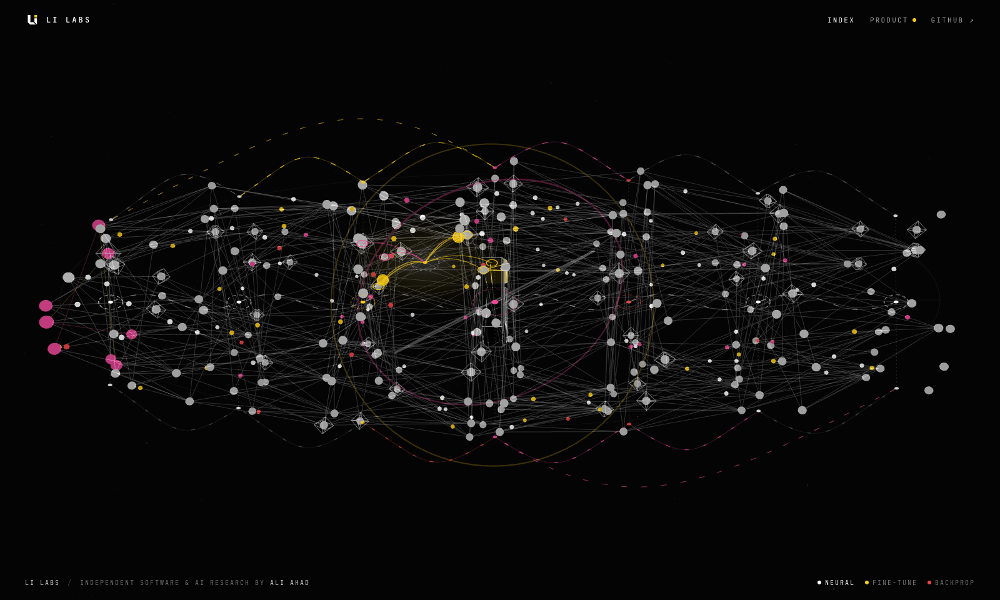
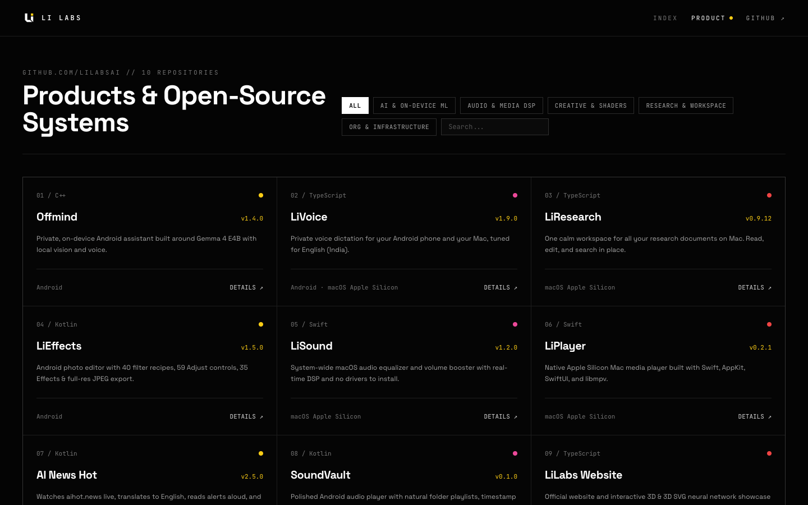

# LI Labs (`lilabs.aliahad.com`)

[](https://lilabs.aliahad.com)
[](https://lilabs.aliahad.com/product)
[](./LICENSE)

Official website and interactive 3D neural network showcase for **[LI Labs](https://github.com/LiLabsAI)**, an independent software and AI research initiative founded by **[Ali Ahad](https://aliahad.com)**.

> **Mission**: Make technology smarter, simpler, and more accessible by building innovative software, intelligent applications, and developer tools that solve real-world problems.

---

## Preview

### `/` — Interactive 3D & 3D SVG Neural Network Showcase


### `/product` — Open-Source Ecosystem & Interactive Product Detail Modals


---

## Highlights

- **Full-Viewport, Zero-Scroll 3D Neural Network (`/`)**:
  - Scales fluidly to any monitor resolution (`100vw × 100dvh`, `overflow: hidden`) with zero text over the 3D canvas.
  - **7-Layer 3D Transformer & LoRA Architecture**: 206 interactive 3D neurons (`THREE.OctahedronGeometry` & `THREE.IcosahedronGeometry`), 680+ vertex-colored synaptic connections, 140 traveling signal pulses, and a central 3D wireframe `Li` core with gyroscopic rings.
  - **Synchronized 3D-to-2D SVG Overlay**: Vue.js 3.5 reactive SVG layer projecting live 3D layer centroids into 2D screen space to render residual skip-connections, magnetic cursor-to-neuron Bézier filaments, and fine-tuning wave rings.
  - **Minimalist Monochrome Palette with Signal Accents**: Pure black (`#040404`) and white (`#FFFFFF`) canvas accented with **Yellow (`#FACC15`)**, **Red (`#EF4444`)**, and **Pink (`#EC4899`)** neural signals.
  - **Mouse-Driven Interaction**: Smooth frame-rate-independent pointer orbit (`alpha = 1 - Math.pow(1 - 0.055, dt * 60)`), magnetic neuron excitation, click-to-trigger fine-tuning shockwaves, 360° drag rotation, and smooth wheel zoom.
- **Open-Source Repository Showcase (`/product`)**:
  - Showcases all 10 **LI Labs** repositories (`offmind`, `LiVoice`, `LiResearch`, `LiEffects`, `LiSound`, `LiPlayer`, `ainewshot`, `SoundVault`, `LiLabs`, `.github`) in a minimalist monochrome grid.
  - Clicking any repository opens an accessible **Product Detail Modal** with verified **Details**, **Features & Highlights**, **Requirements & Stack**, and **Releases & Artifacts**.

---

## Tech Stack

| Layer | Technology |
| :--- | :--- |
| **Language** | TypeScript 5.9 |
| **3D & App Shell** | React 19 + Three.js (`WebGLRenderer`, custom vertex-colored shaders & instanced geometry) |
| **3D SVG Overlay & Catalog** | Vue.js 3.5 (mounted via `VueBridge.tsx` and synchronized at 60fps via `labStore.ts`) |
| **Styling** | Tailwind CSS v4 |
| **Edge Runtime** | Cloudflare Workers (`lilabs-web`) with MPA static asset routing, `/404.html`, and JSON API endpoints (`/api/repos`, `/api/health`, `/healthz`) |

---

## Project Structure

```text
.
├── .github/workflows/ci.yml   # Typecheck, lint, test, and build verification
├── AGENTS.md                  # Design & engineering guardrails for AI agents
├── LICENSE                    # GNU General Public License v3.0 (GPL-3.0)
├── cloudflare.config.ts       # Cloudflare Worker configuration (observability + traces enabled)
├── docs/preview/              # Repository preview screenshots
├── index.html                 # Entry HTML for `/` (Full-screen 3D neural showcase)
├── product/
│   └── index.html             # Entry HTML for `/product` (Repository catalog)
├── public/
│   ├── 404.html               # Custom 404 page
│   ├── _headers               # Cloudflare static asset security & caching headers
│   ├── brand/                 # Monochrome LI Labs SVG mark
│   └── favicon.svg            # Site icon
├── scripts/
│   └── build-cf.mjs           # Bundles Vite static assets + Worker into `.cloudflare/output`
└── src/
    ├── components/
    │   ├── react/
    │   │   ├── NeuralForge3D.tsx               # Three.js 3D neural network & LoRA showcase
    │   │   ├── SiteChrome.tsx                  # Minimal floating header & footer chrome
    │   │   └── VueBridge.tsx                   # React 19 <-> Vue 3.5 lifecycle bridge
    │   └── vue/
    │       ├── NeuralSvgOverlayVue.vue         # 3D-projected SVG synaptic overlay on `/`
    │       └── ProductCatalogVue.vue           # Repository matrix & Product Detail Modal
    ├── data/
    │   └── repos.ts           # Verified metadata, highlights & requirements for LiLabsAI repos
    ├── store/
    │   └── labStore.ts        # Shared reactive store across React 19, Vue 3.5 & Three.js
    ├── styles/
    │   └── main.css           # Minimalist monochrome + Yellow/Red/Pink design tokens
    ├── utils/                 # Shared font activation and URL sanitization utilities
    └── worker.ts              # Cloudflare Worker entry point & API handlers
```

---

## Local Development & Deployment

### Prerequisites
- Node.js 22+
- `pnpm` 12+
- Cloudflare `cf` CLI (for deployment)

### Install, Check & Run Locally

```bash
pnpm install
pnpm run check       # Runs typecheck (tsc + vue-tsc), Biome lint, and Vitest suite
pnpm run dev         # Starts Vite frontend dev server
pnpm run dev:worker  # Runs local Cloudflare Worker dev server via cf dev
```

### Build for Production (Vite + Cloudflare Worker Bundle)

```bash
pnpm run build
```

### Deploy to Cloudflare Workers

```bash
pnpm run deploy
```

---

## License

Copyright (C) 2026 [Ali Ahad](https://aliahad.com) / [LI Labs](https://github.com/LiLabsAI).

This program is free software: you can redistribute it and/or modify it under the terms of the **GNU General Public License as published by the Free Software Foundation, either version 3 of the License, or (at your option) any later version**. See [LICENSE](./LICENSE) for full details.
